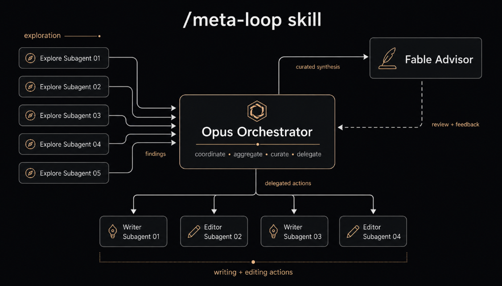
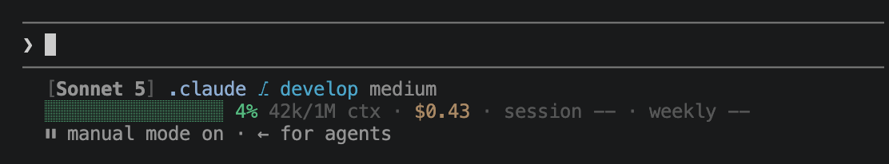

<div align="center">

# `~/.agents`

**devs only want agents who have great SKILLs**

[](LICENSE)
[](https://agentskills.io)


</div>

TL;DR: agent skills, commands, and configs.

This repo contains agent skills, subagents, slash commands, hooks and harness-specific setup specs for Claude Code, Codex, Cursor, Copilot, etc.
`~/.agents/skills/` is a cross-harness convention, so most harnesses can read the skills as soon as they're cloned.
Skills follow the open [Agent Skills](https://agentskills.io) standard.

## Install

Clone the repo to `~/.agents`:

```bash
git clone https://github.com/thefilesareinthecomputer/dotagents ~/.agents
```

Most harnesses pick the skills up with no further step.
Claude Code reads only `~/.claude`, so link the skills, subagents and commands into it:

```bash
bash ~/.agents/sync-skills.sh --dry-run   # preview
bash ~/.agents/sync-skills.sh
```

The script adds one symlink in `~/.claude/skills`, `agents` and `commands` for each entry in this repo.
It leaves any entry already in `~/.claude` alone and removes links whose source was deleted.
It is safe to re-run; run it after any pull that adds or removes an entry.
Skills hot-reload; a new subagent or command registers after a session restart.

## Harnesses

| Harness | Setup | Note | Spec |
|---|---|---|---|
| **Claude Code** | `sync-skills.sh` | Reads skills, subagents and commands; the fullest station spec | [SPEC-CLAUDE-CODE](specs/claude-code/SPEC-CLAUDE-CODE.md) |
| **Antigravity CLI** | one `skills.json` pointer | Reads `.agents/` per project, not `~/.agents/` globally | [SPEC-ANTIGRAVITY](specs/antigravity/SPEC-ANTIGRAVITY.md) |
| **Codex CLI** | none | Its privacy switches are a four-key `config.toml` fragment | [SPEC-CODEX](specs/codex/SPEC-CODEX.md) |
| **GitHub Copilot** | none | Strictest skill parser of the set | [SPEC-COPILOT](specs/copilot/SPEC-COPILOT.md) |
| **Cursor** | none | Subagents load per repo: `sync-skills.sh --cursor <repo>` | [SPEC-CURSOR](specs/cursor/SPEC-CURSOR.md) |
| **deepagents** | in code | Skill paths are passed to `create_deep_agent` | [SPEC-DEEPAGENTS](specs/deepagents/SPEC-DEEPAGENTS.md) |
| **Gemini CLI** | none | Retired for consumer tiers; see Antigravity | [SPEC-GEMINI](specs/gemini/SPEC-GEMINI.md) |
| **goose** | none | If it misses `~/.agents`, use `.goose/skills/` in the project | [SPEC-GOOSE](specs/goose/SPEC-GOOSE.md) |
| **Kimi Code CLI** | none | | [SPEC-KIMI](specs/kimi/SPEC-KIMI.md) |
| **opencode** | none | `opencode debug skill` shows what it found | [SPEC-OPENCODE](specs/opencode/SPEC-OPENCODE.md) |
| **Pi** | none | Finds only `<name>/SKILL.md` folders | [SPEC-PI](specs/pi/SPEC-PI.md) |

Every harness in the table can load `skills/`.
The subagents in `agents/` and the slash commands in `commands/` are Claude Code formats.
Claude Code reads both through the sync, Cursor reads the subagents in a repo after `sync-skills.sh --cursor <repo>`, and the other harnesses ignore both folders.
To make a subagent or command work everywhere, rewrite it as a skill.
Two optional skill fields keep the original behavior in Claude Code and Copilot: `disable-model-invocation: true` runs the skill only when you type its slash command, and `context: fork` runs it in its own subagent.
Other harnesses ignore those fields and load the skill as usual.

[`specs/`](specs/) has one station spec per harness. Each lists the config, plugins, CLI tools, hooks and permission rules that harness needs, including its privacy and remote-control switches.
`seed.py plan --harness all` in the `agent-cc-configs-sync` skill checks a machine against them.
[`specs/HARNESS-PROFILES.md`](specs/HARNESS-PROFILES.md) compares the harnesses with dated evidence.

Because every harness reads the same tree, sessions in different harnesses running side by side share one skill set and the same working rules in [`AGENTS.md`](AGENTS.md).
[`agent-mail`](skills/agent-mail/SKILL.md) lets those sessions message each other through files, with no daemon and no network.

> **Models.** An Ollama `:cloud` model is served remotely and has the same exposure as any hosted API, whatever the local-looking command suggests.
> Ollama stays on loopback: `OLLAMA_HOST` is never set to `0.0.0.0` or any routable address, because that publishes an unauthenticated inference endpoint to the network.

## What's inside

Each entry's own file is authoritative: a skill's frontmatter `description` is its trigger contract and its body is the workflow.

### Skills

**Session lifecycle**

| Skill | What it does |
|---|---|
| `hi` | Session-start orientation: reads the living docs, memory and git state, then names the next action. Read-only. |
| `focus` | `/focus` for a session that drifted: the `supervisor` re-derives the user's requests from the record. |
| `cmon` | Restates the last verbose reply in as few words as possible, then holds that register. |
| `notes` | End-of-session docs sweep that also corrects any repo text the session made false. |
| `reflect` | End-of-session memory reconciliation, applied only after the user approves it. |
| `wrap-up` | Closes a session: file review, docs and handoff, commit and push, then memory. |
| `repo-device-sync` | Multi-device git ritual: fetch and diff before work, re-fetch before every push. |

**Orchestration and delegation**

| Skill | What it does |
|---|---|
| `meta-loop` | Plan, fan out to parallel workers, verify each result, synthesize, with an `advisor` consulted off the hot path. |
| `deep-research` | Multi-angle web research with parallel researchers, cross-validated and cited. |
| `task` | `/task <harness>` hands one bounded task to Codex, Cursor or Antigravity in an isolated worktree; `/task tryout` benchmarks a candidate harness. |
| `agent-review` | One outside model reviews a user-approved file set in a single headless call with no tools. |
| `agent-conference` | Panel review for high-stakes questions: several harnesses answer, rank each other blind, and a chair synthesizes. |
| `local-model-task` | Hands one bounded text or search task to a local Ollama model on loopback. |
| `support-local` | A Haiku worker drives the local models over a named corpus and returns one JSON answer whose quotes the script checks. |

**Knowledge, vaults and planning**

| Skill | What it does |
|---|---|
| `markdown-kg` | Offline section-level knowledge graph over any markdown corpus. |
| `code-kg` | Offline symbol-level knowledge graph over a codebase: imports, liveness, subsystems, coupling hotspots. |
| `obsidian` | Obsidian markdown standard plus a per-vault authoring workflow. |
| `project-knowledge-vault` | Seeds and lints a flat project vault: the contract, a scaffolder and a linter. |
| `gather-learnings` | Sweeps a vault's dated notes and the running session into its learnings file. |
| `compact-notes` | Rewrites one meeting-note section into a fixed summary format, with a backup and a verify. |
| `get-ready` | Claims audit before a meeting or a piece of work, written into the vault's run sheet. |
| `pr-review` | Drafts PR comments and replies in the user's voice, in both directions. |
| `sprint-board` | Plans, writes and audits agile backlogs as markdown, with a scaffolder and a linter. |
| `teach-me` | Teaches a topic and certifies understanding with a scored retrieval check. |
| `ai-engineering` | AI and agent stack knowledge from a dated catalog, with read, write and build modes. |

**Writing, UI and media**

| Skill | What it does |
|---|---|
| `ai-slop-magic-eraser` | Rewrites prose to the user's voice with the meaning fixed, and flags what looks invented. |
| `frontend-aesthetics` | Raises UI past the defaults that read as AI-generated, and verifies the rendered result in a browser. |
| `compress-media` | `/compress-media` shrinks or converts video, audio and images with ffmpeg into a `_small` copy beside each original. |

**Security and station**

| Skill | What it does |
|---|---|
| `sanitize` | Deterministic scrubbing engine, and the commit and push gate behind the global git hooks. |
| `my-security-review-checklist` | Pre-merge security gate for agent tooling, including checks for hidden Unicode. |
| `skill-authoring` | House profile for authoring and auditing skills, subagents, commands and hooks. |
| `agent-cc-configs-sync` | Seeds or reconciles a machine's harness configs and hooks against `specs/`. |
| `agent-mail` | File-based messages between agents working separate repos on the same machine. |

### Subagents (`agents/*.md`)

| Subagent | What it does |
|---|---|
| `advisor` | Consulted by `meta-loop` on strategy, decomposition, risk and proportion. |
| `ai-engineer` | Fresh-context builder for delegated AI and agent work. |
| `curator` | Owns how reader-facing work reads and looks; edits in place with `ai-slop-magic-eraser`. |
| `my-security-reviewer` | Applies the security checklist to a diff before it ships. |
| `reader` | Read-only fan-out worker: answers one bounded question with findings. |
| `researcher` | Source-cited researcher for one angle; the `deep-research` worker. |
| `supervisor` | Spawned only by `focus`; flags drift and landmines with a root-cause section. |
| `support-local` | The `support-local` worker, pinned to a Haiku model; cannot spawn agents. |
| `worker` | Fan-out worker that changes the tree and returns evidence of what it changed. |

### Commands (`commands/*.md`)

| Command | What it does |
|---|---|
| `/advisor` | Asks the `advisor` subagent one question about a plan. |
| `/agent-mail` | One agent-mail action: send, read, list or reply. |
| `/cmon` | Restates the last verbose reply in as few words as possible. |
| `/my-security-review` | The agent-tooling security review, with `my-security-reviewer` for depth. |
| `/reflect` | Memory reconciliation: propose, wait for approval, apply. |
| `/voice` | Turns the spoken reply summaries on or off, or reports their state. |
| `/wrap-up` | Closes the session: review, inbox and notes, commit and push, then reflect. |
| `/spec` `/plan` `/build` `/test` `/review` `/ship` `/code-simplify` | The house procedure for each stage, self-contained. |

The seven stage commands defer to their counterparts in Addy Osmani's [`agent-skills`](https://github.com/addyosmani/agent-skills) plugin when it is installed, and work without it.
Upstream skills come from installed plugins, never from this tree; [`SPEC-CLAUDE-CODE.md`](specs/claude-code/SPEC-CLAUDE-CODE.md) section 3 lists them.

## In practice

[`meta-loop`](skills/meta-loop/SKILL.md) runs long sessions as an orchestration loop.
Explore subagents search in parallel and return only their findings.
The orchestrator curates them into a synthesis, sends it to the [`advisor`](agents/advisor.md) for review, then delegates the writing and editing to a second wave of subagents.
Each result is checked against acceptance criteria and evidence rather than the worker's own summary.



No single agent fills its context window, so several short threads cost less in total than one long thread that maxes out and compacts.
Each call names its model tier rather than inheriting one.

The status line shows the model, folder, branch, reasoning effort, context, session cost and rate-limit use on every prompt.
Both scripts and what each field means are in [`specs/claude-code/`](specs/claude-code/SPEC-CLAUDE-CODE.md), section 9.



## Design principles

**Every skill here fixes something the model gets wrong on its own.**
`frontend-aesthetics` exists because default UI taste is bad.
There is no generalized backend skill, because there is no generalized backend mistake to correct, and a skill that only repeats what the model already knows never fires anyway.
Retired skills wait in `skills-archive/` until their stack is in play again.

**Prose does not stop an agent from doing anything.**
Tell a subagent it is read-only and hand it `Bash`, and it will edit your files.
Advisory agents get a read-only `tools:` allowlist instead, because that is the part the harness enforces.

**Nothing grades its own homework.**
A checklist run by the model that wrote the code is theater, so the mechanically checkable parts ship as scripts that exit non-zero: `slop_check.py` for machine-writing tells, `unicode_smuggle_check.py` for instructions hidden in invisible characters.
Judgment stays in the prose.

## Layout

```
~/.agents/
  skills/          one folder per skill, each with a SKILL.md and its own scripts and tests
  skills-archive/  retired skills; not synced, restored with git mv
  agents/          one .md per subagent
  commands/        one .md per slash command
  hooks/           cross-harness hook scripts and their manifest
  hooks/git/       global git hooks: the sanitize gate at commit and push
  specs/           one folder per harness: station spec and seed files
  tests/           station hook suites and repo-wide checks
  app/             the agents chat app, its own uv project
  sync-skills.sh   links skills, agents and commands into ~/.claude
  AGENTS.md        the rules every agent works under
```

Third-party plugins load from their own cache under `~/.claude/plugins/` and never read or write here, so updating one cannot change a skill in this tree.

## More

- [`AGENTS.md`](AGENTS.md) - the rules every agent works under, in every harness. Claude Code loads it through the one-line pointer in [`specs/claude-code/CLAUDE.md.example`](specs/claude-code/CLAUDE.md.example).
- [`SPEC.md`](SPEC.md) - what this repo is, its scope and invariants.
- [`CONTRIBUTING.md`](CONTRIBUTING.md) - setup, branches, skill conventions, verification and style.
- [`SECURITY.md`](SECURITY.md) - reporting a vulnerability in a repo whose payload is instructions an agent executes.

## License

[MIT](LICENSE).
