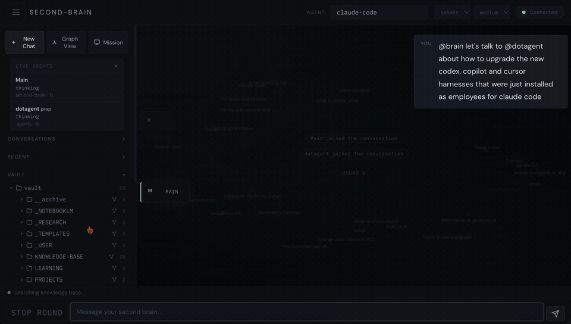
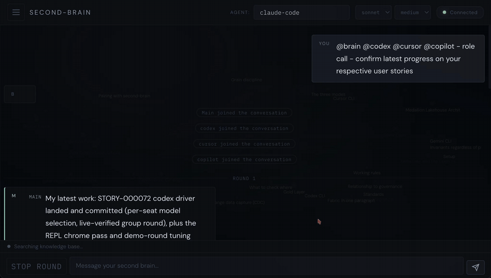
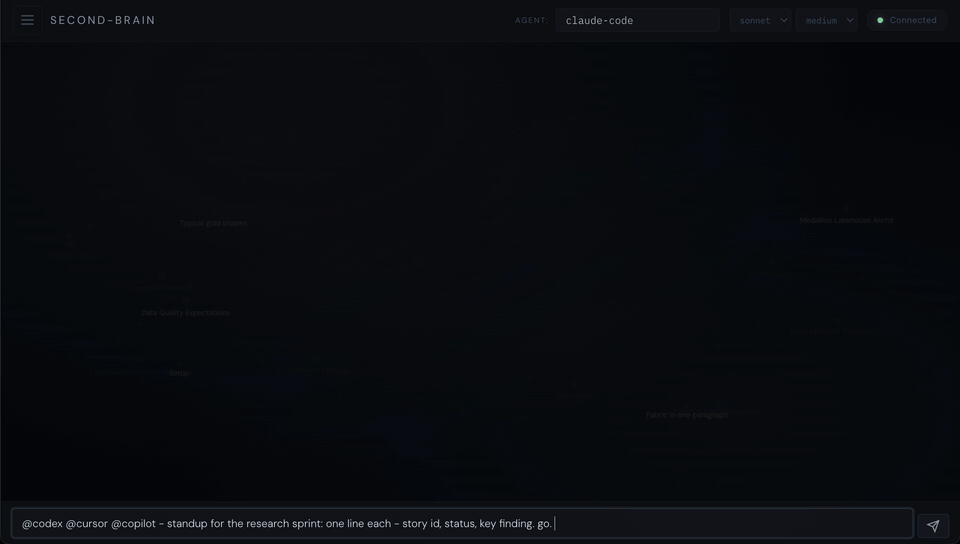
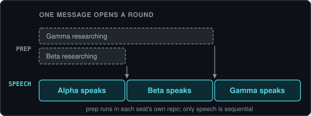
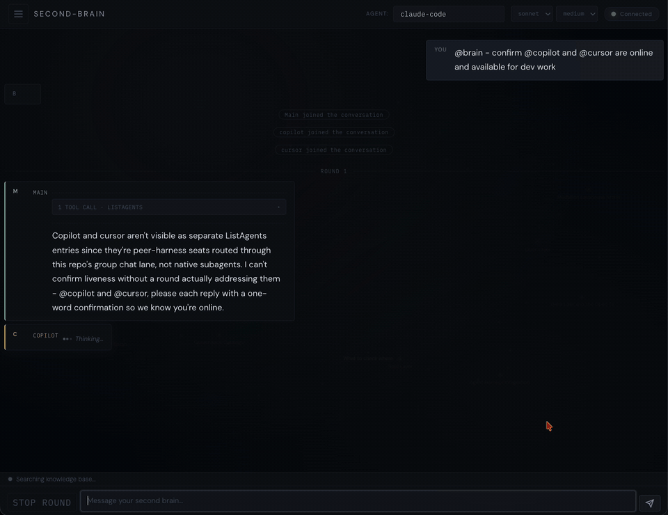

<div align="center">

<h1>agents</h1>

<p><strong>Brainstorm and collaborate with all your agents.</strong></p>

<p>A markdown vault, a local chat app with real multi-agent group threads, and a live knowledge-graph HUD - driven by your own agent harness.</p>

<p>
  <a href="LICENSE"></a>
  
  
  
</p>



<p>
  <a href="#what-makes-it-different">Why</a> |
  <a href="#the-vault">The vault</a> |
  <a href="#quickstart">Quickstart</a> |
  <a href="#cli-surface">CLI</a> |
  <a href="#chat-lanes">Chat lanes</a> |
  <a href="#group-chat-seat-your-other-agents">Group chat</a> |
  <a href="#graphs-nested">Graphs</a> |
  <a href="#development">Development</a>
</p>

</div>

Chat with all your agents: `agents up` opens a browser with chat, the vault's file tree, and a graph that lights up as the agent reads and searches your notes; `agents chat` is the same agent in the terminal.

## What makes it different

- **One knowledge base, every agent.** Agents normally keep what they learn in their own private context, where it is lost when the session ends and nobody else can correct it. Here they all read from and write back to the same vault, and you edit it directly alongside them, so a correction one agent makes reaches every agent, and the knowledge base can be shared across people as easily as across agents. Group chat serves the same goal: seats bring what their own repos know into one thread.
- **The chat agent is your agent.** Chat drives a real Claude Code session over this repo (the app shells out to `claude -p`, no SDK), so your own skills, subagents, and permission rules load natively, and turns bill to your Claude subscription instead of metered API usage. Any harness that can run bash can drive the whole CLI and HTTP surface; `AGENTS.md` documents it.
- **Group chat seats other real agents.** Each seat is a persistent harness session in its own repo, under that repo's committed permissions. Claude Code, Cursor, GitHub Copilot and Codex share one thread, answer in attributed turns, and do real file work in their own workspaces from the conversation.
- **The graph is session memory.** Nodes light up and stay lit as the agent reads them, so by the end of a session the graph shows which notes the answer was built from.
- **Local-first with an offline fallback.** The server binds 127.0.0.1, search is SQLite FTS5 plus a typed knowledge graph (no vector store, no embeddings), and chat degrades gracefully to a local Ollama model. There is no Docker, no Node and no build step.

## The vault

Any folder of markdown is a vault; point the app at yours with `agents config set vault`. The sample vault here uses a tiered layout the graph colors by:

| Folder | Role | Graph color |
|---|---|---|
| `KNOWLEDGE-BASE/` | Settled notes | gold |
| `_RESEARCH/` | Dated research, pending review | grey |
| `LEARNING/` | Study records | violet |
| `PROJECTS/` | Workspaces that draw on the knowledge base | teal |
| `_TEMPLATES/`, `_NOTEBOOKLM/`, `_USER/`, `__archive/` | Templates, study packs, personal ledger, history | not indexed |

The tiers are a layout convention rather than a mechanism: this app indexes, searches and chats over whatever the vault holds, and agents write to it with their own tools under their own permissions. A knowledge lifecycle that promotes research into settled notes through certification and a merge gate is a separate set of skills that lives with the vault that runs it, outside this app.

## Quickstart

**Required:** [uv](https://docs.astral.sh/uv/) on macOS or Linux is the whole base requirement; uv fetches Python 3.12+ by itself if the machine lacks it.

**One chat backend:** any one is enough, and with several installed the app picks the best available at runtime.

| Backend | What you get | Setup |
|---|---|---|
| [Claude Code](https://claude.com/claude-code) CLI, logged in (recommended) | the full agent: skills, subagents, group seats; bills your Claude subscription | install `claude`, run it once to log in |
| [Ollama](https://ollama.com) | fully offline chat | `ollama pull qwen3:4b` (any tool-capable model works) |

**Optional:** the `cursor-agent`, `copilot` and `codex` CLIs are needed only if you want Cursor, GitHub Copilot or Codex seats in group chat.

With those in place, run the app from its own folder; it lives inside the skills repo as its own `uv` project:

```bash
cd ~/.agents/app
uv sync
uv run agents up         # first run writes a default config, then your browser opens
```

The first `agents` command asks no questions: it writes a working default config to `~/.agents-app/config` and tells you it did. Change anything whenever you want: `agents config` runs the interactive wizard, `agents config set <key> <value>` changes one key, or you can ask the chat agent. The vault here is a sample vault plus the app's own docs. Anything private belongs in a vault of your own; point the app at it with `agents config set vault ~/path/to/your/vault`, then run `agents build`.

To put `agents` (and its alias `agn`) on your PATH globally:

```bash
uv tool install -e .     # editable: the app resolves its vault, UI and engine from this folder
```

To work in the terminal instead of the browser, `uv run agents chat` starts everything without opening one.

Uninstall is three commands: `agents down`, `uv tool uninstall agents-app` (if you installed globally), and `rm -rf ~/.agents-app`. The only other things written are inside this folder: `data/` (conversations), `vault/vault-kg/` (the built index) and `.venv/`, all gitignored.

Environment variables override stored config per invocation:

| Variable | Meaning | Default |
|---|---|---|
| `AGENTS_APP_VAULT` | Vault directory | `<repo>/vault` |
| `AGENTS_APP_DATA` | Conversations and app data | `<repo>/data` |
| `AGENTS_APP_HOST` / `AGENTS_APP_PORT` | Bind address | `127.0.0.1:8765` |
| `OLLAMA_URL` | Local Ollama daemon | `http://localhost:11434` |

## CLI surface

```
agents up        # launch server + open browser
agents chat      # chat with the agent in the terminal; `agents chat <id>` resumes a conversation
agents down      # stop the server and every agent process it spawned (unloads app-loaded local models)
agents build     # rebuild the vault knowledge graph
agents config    # interactive setup wizard (first run writes defaults instead of asking)
agents config get [key]          # print one effective setting, or all of them
agents config set <key> <value>  # change one setting (validated; notes when a restart is needed)
agents model     # show models; `agents model <name>` sets the default (and lane)
agents seat      # show the seat roster; `add`/`remove` manage it, `<conversation-id> <name>` invites a guest
agents search    # query the vault knowledge graph from the CLI (the chat agent's retrieval path)
agents           # no args: status + help
```

- `agn` is a full alias for `agents`.
- The server is a detached background process, and the browser tab is just a client - closing the tab does not stop it. `agents up` is idempotent: it records pid and port in `~/.agents-app/`, and a second run focuses the open tab instead of starting a duplicate. `agents down` is the off switch: it signals the whole process group, so every agent CLI the server spawned dies with it and app-loaded local models unload.
- `agents chat` is the same agent in the terminal: same lanes, same conversation store, so a thread started in the terminal continues in the web UI and back. It starts the server if needed (without opening a browser); Ctrl-C cancels a turn, Ctrl-D leaves.
- Settings are also conversational: ask the chat agent to change them and it uses the allowlisted `agents config get` / `set` (validated keys, loopback-only `ollama_url`, a restart note for `vault` / `data` / `host` / `port`).
- Day to day: `agents up`, work in the web UI or edit the vault in Obsidian or any editor (the graph re-indexes on drift), `agents down`. `agents build` forces a rebuild after bulk outside edits.

## Status

In development. Live and tested today:

- the CLI (including a terminal chat REPL and `config get/set`) and served UI, vault browsing and search
- both chat lanes (Claude Code session, offline Ollama), with per-conversation model pinning
- group chat over a global seat roster: sequential rounds, parallel background prep, Cursor, Copilot, and Codex seats, mission control
- the knowledge-graph HUD with scoped per-folder views and session-memory heat
- unit, endpoint, and real-server e2e test tiers

Still to come: in-place editing, upload, opencode / gemini seat drivers, and the OpenAI-compatible lane. Every section marks what is not live yet.

## Chat lanes



The app picks the best available lane at runtime; every lane is optional and none is an install-time dependency.

**Claude Code (primary).** With the `claude` CLI installed and logged in, each conversation is one persistent session ("New Chat" starts fresh), and your skills, subagents, and permission-gated git work from the chat window as well as the terminal.

- Launched agents default to `--model sonnet` at `--effort medium` for fast turns. Header selectors change tier and effort on the spot (`claude_model` / `claude_effort` in `~/.agents-app/config`); a seat's roster `model` overrides its tier.
- A `claude` CLI backed by a local model (for example via Ollama's Claude Code integration) is inherited unchanged: full skills and subagents, fully offline.

**Ollama (offline fallback).** Install [Ollama](https://ollama.com) and pull a tool-capable model sized to your machine:

```bash
ollama pull qwen3:4b     # a small tool-capable model; any model works
```

- The in-app model switcher pins any lane to the open conversation, or as the app default. `agents model` does the same from the terminal.
- With no harness CLI present, chat falls back to Ollama, so the app still works fully offline. Models without tool support degrade to plain chat.
- The daemon releases a model `ollama_keep_alive` after its last reply (default 5m; `0` unloads per turn), and `agents down` unloads anything the app loaded.
- **Lockdown:** the app talks only to a loopback Ollama daemon, and a non-local `OLLAMA_URL` is refused. Cloud models (`:cloud` tags) go through the local daemon's proxy, with no traffic to a public Ollama API. Pin the daemon itself to loopback too: on macOS run `launchctl setenv OLLAMA_HOST "127.0.0.1:11434"`, and on Linux set `Environment=OLLAMA_HOST=127.0.0.1:11434` in the systemd unit.

**Planned.** An OpenAI-compatible lane (OpenAI, Gemini, OpenRouter) is specced with config keys reserved; the driver ships after v1. Setup's `harness` choice accepts claude, codex, opencode, cursor, copilot, gemini, or none; opencode and gemini seats can be defined but fail loudly until their drivers ship.

## Group chat: seat your other agents



Seats exist because the knowledge is spread across repos and sessions that no single agent sees; a single agent could read the vault and answer from it, so extra capacity is not the reason. Each seat arrives with what its own workspace knows, the thread is where those views get reconciled, and what is written back to the vault becomes knowledge all of them inherit. One agent cannot do that, because it only knows its own side.

Every conversation starts as a plain two-party chat. @-mention a seat (`@codex take a look`) and it joins the thread - a real agent session running in its own repo alongside this vault's agent.

- **Roster.** Seats live globally in `~/.agents-app/seats.json` (`agents seat add <name> <repo>` / `agents seat remove <name>`). An unknown `@name` shows a "not a seat" notice; seat it permanently or invite it as a one-conversation guest (the Seats sidebar picker does the same by hand).
- **Sessions.** Each seat keeps its own working directory, context, and that repo's committed permissions. An invited seat gets the attributed transcript as catch-up, and sessions never bleed across conversations - two threads holding the same rostered agent are two independent sessions.
- **Permissions you can see.** A seat runs under its own repo's settings, and this app only ever narrows that: a fixed deny set rides every spawn (no grant or rule edits, no plugin or harness re-spawns; pushes are decided by the seat repo's own committed allow list), and a seat in a rules folder is read-only. Every refused call shows in the activity rail with the reason and the rule that refused it, and each seat row has a policy card listing exactly what will be passed before a turn runs. Nothing in the UI can widen a grant; that stays a change you make in the seat's own repo.
- **Reopening a thread picks the same sessions back up.** A conversation stores its own session reference and one per seat, in the conversation file on disk, so the next turn resumes each of them where they left off - the main agent and every seat, across a restart of the app or the machine. Nothing runs in between: a turn spawns a CLI, streams, and exits, so a thread costs nothing while you are not talking to it. Unseating an agent drops its reference, and re-seating that name starts a fresh session rather than reattaching.
- **Rounds.** One message triggers a round: the orchestrator (the main agent, seated automatically with the first guest) speaks first on unscoped messages, every seat takes a real turn or passes (a muted chip), capped at 2 rounds and 6 agent turns per message. The main agent displays as Main and answers to `@main`, `@agents`, `@agn`, or `@app`; a message @-scoped to other seats skips it.
- **Parallel prep.** While one seat speaks, other addressed seats research your question in their own repos in the background (a "prep" pulse on their roster row). Turns stay strictly sequential; only the background prep overlaps.



- **Mission control.** The **Mission** button opens a live panel - one row per active turn with state, current tool, elapsed time, and spawned subagents - plus a **stop round** control.
- **Cursor, Copilot, and Codex seats.** `agents seat add <name> <repo> cursor` (or `copilot`, `codex`) seats that CLI in its own workspace with a resumable session; a seat's roster `model` rides the spawn, so a fast small model per seat is one config field. In live use, a Copilot seat has completed a real development task from a group turn, and a Codex seat answers from its own repo (workspace-write sandbox, no bypass flags).

## Graphs, nested



One index covers the whole vault; every folder gets its own graph as a live view of it - the knowledge base, each project, research, learning, whole-vault - from the same database with no extra indexing. Links that cross a folder boundary are the interesting ones, so a scoped view keeps and marks them: a project's graph shows exactly which knowledge it stands on. (A combined code+vault graph arrives with the code-kg integration.)

The HUD behind the chat works as session memory. Nodes start dim; when the agent searches or reads a note, that node brightens, pulls toward the center, and stays lit, so by the end of a session the graph shows exactly which notes the session used. Motion honors `prefers-reduced-motion`.

## Search

The sidebar field searches the graph's section index (ranked FTS5 with graph-aware scoring), with a toggle to search file names instead of contents.

No embeddings required: there is no vector store or embedding dependency anywhere, by design.

## Security posture

Single-user, local. The server binds `127.0.0.1` by default; there is no auth because nothing is exposed.

- Markdown from agents is sanitized before it renders (chat and viewer). Model text passes through an allowlist of the tags and attributes markdown itself produces, so injected markup is inert rather than merely unrecognized. Behind that, a page-level Content Security Policy refuses inline script outright and keeps anything that slipped through from making an automatic request to anywhere but the font CDN the page already loads - the UI contains no inline event handlers, which is what lets the policy be that strict, so a sanitizer miss is not fatal on its own. Do not expose the port to a network regardless; there is still no auth, because nothing is meant to be exposed.
- `vault/_USER/` holds your personal mastery ledger. Keep it (and anything personal) out of any public fork - `agents config` records your ignore choices.

Because the app spawns other agents, a seat's output is treated as untrusted input to the app itself:

- **Seats get fewer grants than the main lane.** The repo's permission rules ride every spawn explicitly, minus the grants that would let a seat change the roster or the app's own configuration. Deny rules are never relaxed for a seat, and cover the usual credential stores (ssh, cloud, token files, each harness's auth file).
- **Seats are confined to `seat_roots`** - the directories you allow them to run in. It is the one setting no agent can change: `agents config roots` shows you the file and the exact line to edit, and writes nothing itself.
- **Nothing an agent says authorizes a privilege change.** Permissions, the roster, configuration, and dotfiles change on your instruction only; a reply cannot forge a turn from you, and `host` cannot be moved off loopback by a command.
- **No invisible ink between agents.** Every agent reply is sanitized before it enters the thread: zero-width characters, bidi overrides, Unicode tag-block smuggling, and raw terminal controls are stripped at persistence, so a seat cannot pass another seat a payload you cannot see. Your own messages are never rewritten.
- **Spawned CLIs get an allowlisted environment**, so no API key or token in your shell leaks into a third-party CLI or flips it onto metered billing (`AGENTS_APP_SPAWN_PASSTHROUGH` names extras when a harness needs one).

These are pinned by tests, including an end-to-end tier that drives them through the real HTTP surface and a live round. `seat_roots` is re-checked at every spawn rather than only when a seat is added, so the conversation file is never the authority on where a seat runs.

**What this is not: seats are not isolated from each other.** Every seat runs under your own user account, deliberately, so they all inherit the same skills. Harness permission settings reduce what a seat is likely to do; they do not bound what it can reach. Verified by probe on 2026-08-29: none of the harnesses here confines reads - codex's sandbox is a write boundary, and copilot's print mode runs shell regardless of its deny flags. So a seat can read other seats' repositories, harness credential files, and this vault. That is an accepted trade for shared tooling on a single-user machine, not a gap we missed; seat only what you would run yourself.

## Development

```bash
uv run pytest            # test suite
uv run agents up         # run from the repo
```

Work happens on `develop`; `main` advances only after each feature is verified. The knowledge-graph engine is the `obsidian-kg` skill's own script, `skills/obsidian-kg/scripts/obsidian_kg.py`, loaded by path; there is no copy here, and changes to it belong in that skill. Runtime dependencies are `fastapi` and `uvicorn` and nothing else; the app never holds an API key. Large vaults: the automatic re-index on drift takes a few seconds, inline on the first read after a change.
