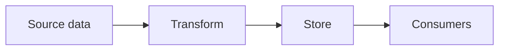

# Docs: Architecture

A `docs-*` note holds a design or reference document the project produced or depends on. Long source documents that arrive as PDFs or exports go in `raw/`; this note distills them into linkable markdown.

## Shape

## Decisions

- One decision per bullet, with its one-line why, so [[PROJECTS/PROJECT-A/user-stories-backlog|user-stories-backlog]] items can cite them.
